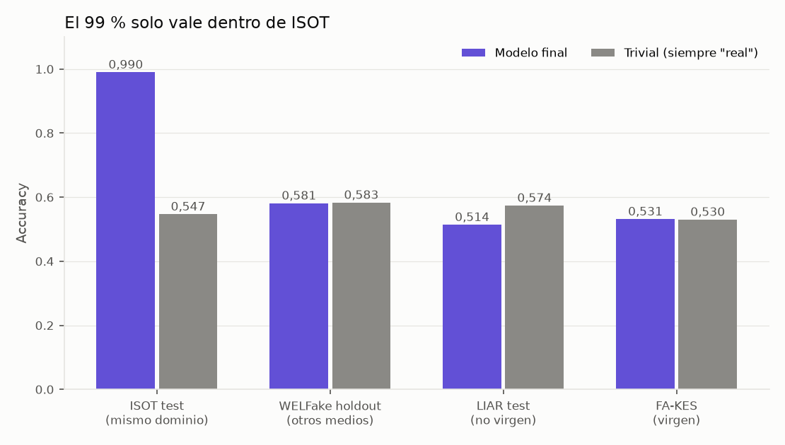

# Informe final — Detector de Fake News

**Materia:** Inteligencia Artificial (UCA, 2026) · **Docentes:** Germán Lamartine, Javier Adolfo Ouret
**Equipo:** Tomás Cortina, Martín Coronel, Mateo Denti, Mateo Devoto, Fabricio Pompozzi

Las tablas de este informe se generan desde `reports/` con `python -m fakenews.cli report`.
Semilla 42.

## Resumen ejecutivo

Construimos un clasificador de noticias en inglés que acierta el 99 % dentro de su dataset (ISOT).
Medimos que ese número es engañoso: en ISOT la clase coincide con la fuente, y el modelo aprende la
redacción de cada fuente. En un dataset donde ambas clases vienen de los mismos medios (FA-KES,
evaluado por primera vez al final), su capacidad de discriminar es la del azar. Por eso el sistema final
declara su dominio de validez y no emite veredicto sobre textos ajenos. Esa compuerta funciona con los
estilos que conoce y deja pasar parte de los que no vio.

## 1. Problema y datos

**Problema.** Dado el texto de una noticia en inglés, estimar la probabilidad de que sea falsa
(clasificación binaria, clase positiva: falsa). No es un verificador de hechos.

**Datos** (detalle en `docs/data_card.md`):

| Dataset | Rol | Tamaño final | Qué significa la etiqueta | Licencia |
|---|---|---|---|---|
| ISOT (Kaggle) | entrenamiento, validación, test | 38 199 artículos | **la fuente**: Reuters frente a sitios poco fiables | CC BY-NC-SA 4.0 (según Kaggle) |
| WELFake | externo: desarrollo y holdout | 23 250 artículos | la fuente, según cada dataset de origen | CC BY 4.0 |
| LIAR | externo | 12 836 afirmaciones cortas | veracidad (PolitiFact) | solo investigación |
| FA-KES | holdout virgen | 753 artículos | **veracidad**, con ambas clases de los mismos medios | CC BY 4.0 |

Al verificar los externos aparecieron dos problemas que hubieran invalidado resultados: la descripción
de WELFake está invertida respecto de su CSV, y el 61 % de WELFake era ISOT (se eliminó).

## 2. Método

**Limpieza.** Una sola función para entrenamiento e inferencia, con perfiles:

- `v1`: quita marcas de fuente y plataforma.
- `v2`: además normaliza contracciones y quita días, meses y números.
- `v2_1`: además normaliza espacios y puntuación.
- `v3`: además enmascara vocabulario de agencia.

Antes de dividir se eliminan textos cortos, duplicados exactos y casi-duplicados (MinHash). División
70/15/15 estratificada, sin solapamiento.

**Modelos.** Baseline trivial y regresión logística TF-IDF (acta). Comparación: Naive Bayes, SVM
lineal, árbol y bosque de estilo, ensamble, kNN coseno, red pequeña, LR de n-gramas de caracteres y
embeddings congelados.

**Protocolo.** Las decisiones se tomaron solo con validación y desarrollo: ISOT val, folds de cambio
de `subject`, corte temporal, WELFake dev y LIAR valid. Criterio de selección: promedio de F1 macro en
subject, tiempo y WELFake dev, con pisos de F1 in-domain e invarianza.

**Accesos a conjuntos reservados** (`reports/test_access_log.jsonl`, verificado por
`python -m fakenews.access_log`):

- **ISOT test** se miró en las iteraciones 1, 2 y 3: las cifras de la iteración 3 **no son una
  evaluación virgen**.
- **WELFake holdout** se miró en las iteraciones 2 y 3 (segunda mirada declarada).
- **LIAR** se miró completo en la iteración 1 (registrado de forma retroactiva): su test no es virgen.
- **FA-KES** se tocó una sola vez, al final, una vez por modelo: es la única cifra realmente virgen.

## 3. Resultados

### 3.1 Comparación del acta (mismo ISOT test)

<!-- BEGIN GENERATED:acta -->
| Modelo | Limpieza | Accuracy | Prec. falsa | Rec. falsa | F1 falsa [IC 95 %] | Prec. real | Rec. real | F1 real | Brier | Log-loss |
|---|---|---|---|---|---|---|---|---|---|---|
| Trivial (clase mayoritaria) | v1 | 0,547 | 0,000 | 0,000 | 0,000 [0,0 – 0,0] | 0,547 | 1,000 | 0,707 | 0,2478 | 0,689 |
| LR palabras (baseline) | v1 | 0,986 | 0,988 | 0,982 | 0,985 [0,9815 – 0,9885] | 0,985 | 0,990 | 0,988 | 0,0104 | 0,039 |
| Naive Bayes | v1 | 0,947 | 0,941 | 0,942 | 0,941 [0,9347 – 0,9479] | 0,952 | 0,951 | 0,951 | 0,0408 | 0,142 |
| SVM lineal (final it. 1) | v1 | 0,989 | 0,987 | 0,990 | 0,988 [0,9854 – 0,9911] | 0,991 | 0,989 | 0,990 | 0,0082 | 0,032 |
| Árbol de estilo | v1 | 0,900 | 0,889 | 0,890 | 0,890 [0,8808 – 0,8982] | 0,909 | 0,908 | 0,908 | 0,0743 | 0,665 |
| Bosque de estilo | v1 | 0,927 | 0,924 | 0,913 | 0,919 [0,9105 – 0,9263] | 0,929 | 0,938 | 0,933 | 0,0555 | 0,194 |
| Ensamble | v1 | 0,987 | 0,987 | 0,985 | 0,986 [0,9828 – 0,9892] | 0,988 | 0,990 | 0,989 | 0,0096 | 0,039 |
| kNN coseno | v1 | 0,900 | 0,960 | 0,813 | 0,880 [0,8707 – 0,8905] | 0,863 | 0,972 | 0,914 | 0,0744 | 0,387 |
| Red pequeña (MLP) | v1 | 0,986 | 0,987 | 0,983 | 0,985 [0,9816 – 0,9882] | 0,986 | 0,989 | 0,988 | 0,0106 | 0,043 |
| it2_lrchar_v2 (final) | v2 | 0,990 | 0,987 | 0,990 | 0,989 [0,9859 – 0,9917] | 0,992 | 0,990 | 0,991 | 0,0073 | 0,027 |
<!-- END GENERATED:acta -->

**Baseline frente a modelo final, McNemar exacto sobre el mismo test:**

<!-- BEGIN GENERATED:mcnemar -->
| Solo acierta el baseline | Solo acierta el modelo final | p (McNemar exacto) |
|---|---|---|
| 25 | 45 | 0,0225 |
<!-- END GENERATED:mcnemar -->

**La diferencia, explicada.** El modelo final usa n-gramas de caracteres, que capturan rasgos de
formato además de palabras. Es significativamente mejor que el baseline en este test, pero esa ventaja
viene en parte de un atajo de formato (§3.5): no es evidencia de que entienda mejor el contenido. Los
modelos marcados `v1` son de la iteración 1 y no se reentrenaron.

### 3.2 Modelo final y selección

Con la regla de aceptación pedida, ningún candidato con `v2_1` puede degradar más de 0,02 de F1 macro
ninguna vista frente a la iteración 2:

<!-- BEGIN GENERATED:panel_v3 -->
| Candidato | Perfil | In-domain F1 falsa | Subject | Tiempo | WELFake dev | Invarianza (peor cota sup.) | Robusto | Aceptado |
|---|---|---|---|---|---|---|---|---|
| it2_lrchar_v2 | v2 | 0,988 | 0,737 | 0,896 | 0,594 | 7,05 % | 0,742 | sí |
| lrchar_v21_C10 | v2_1 | 0,984 | 0,705 | 0,858 | 0,529 | 0,40 % | 0,697 | no |
| lrword_v21_C10 | v2_1 | 0,981 | 0,711 | 0,825 | 0,525 | 0,25 % | 0,687 | no |
| svm_v21 | v2_1 | 0,988 | 0,703 | 0,863 | 0,496 | 0,35 % | 0,687 | no |
| emb_minilm_v21 | v2_1 | 0,932 | 0,624 | 0,728 | 0,517 | 0,65 % | 0,623 | no |
<!-- END GENERATED:panel_v3 -->

Ninguno la cumple, así que **se conserva el clasificador de la iteración 2** (LR de caracteres, limpieza
`v2`, calibración isotónica) con las correcciones de calibración y la compuerta de dominio.

**Tensión declarada.** Ese clasificador cumple la regla de aceptación pero **no** el criterio de
invarianza (§3.5). `lrchar_v21_C10` hace lo inverso. La regla se fijó antes de conocer este resultado.
Cambiar de modelo es una línea en `config.yaml` (`final_v3.candidate`), pero requeriría una nueva mirada
a los conjuntos reservados.

### 3.3 Las tres iteraciones

<!-- BEGIN GENERATED:iteraciones -->
| Vista | It. 1 | It. 2 | It. 3 | Trivial |
|---|---|---|---|---|
| ISOT val, F1 macro | 0,990 | 0,989 | 0,989 | — |
| Cambio de subject, F1 macro | 0,739 | 0,737 | 0,737 | — |
| Cambio temporal, F1 macro | 0,905 | 0,896 | 0,896 | — |
| WELFake dev, F1 macro | 0,520 | 0,594 | 0,594 | — |
| LIAR valid, F1 macro | 0,504 | 0,567 | 0,567 | — |
| Puntaje robusto | 0,721 | 0,742 | 0,742 | — |
| ISOT test, accuracy | 0,989 | 0,990 | 0,990 | 0,547 |
| ISOT test, F1 falsa | 0,988 | 0,989 | 0,989 | — |
| WELFake holdout, accuracy | 0,547 | 0,581 | 0,581 | 0,583 |
| WELFake holdout, F1 macro | 0,525 | 0,575 | 0,575 | — |
| LIAR test, accuracy | 0,473 | 0,514 | 0,514 | 0,574 |
| FA-KES, accuracy | 0,511 | 0,531 | 0,531 | 0,530 |
| FA-KES, F1 macro | 0,417 | 0,398 | 0,398 | — |
<!-- END GENERATED:iteraciones -->

Las cifras de ISOT test y WELFake holdout de la iteración 3 son una segunda o tercera mirada. Coinciden
con las de la iteración 2 porque el clasificador es el mismo.

### 3.4 Evaluación final por conjunto

<!-- BEGIN GENERATED:holdouts -->
| Conjunto | n | Accuracy [IC 95 %] | Trivial | F1 macro | F1 falsa | F1 real | ECE | Brier |
|---|---|---|---|---|---|---|---|---|
| ISOT test | 5730 | 0,990 [0,987–0,992] | 0,547 | 0,990 | 0,989 | 0,991 | 0,004 | 0,007 |
| WELFake holdout | 11625 | 0,581 [0,572–0,590] | 0,583 | 0,575 | 0,624 | 0,525 | 0,342 | 0,350 |
| LIAR test (no virgen) | 802 | 0,514 [0,481–0,549] | 0,574 | 0,514 | 0,506 | 0,521 | 0,320 | 0,367 |
| FA-KES (virgen) | 753 | 0,531 [0,497–0,568] | 0,530 | 0,398 | 0,115 | 0,681 | 0,417 | 0,428 |
<!-- END GENERATED:holdouts -->

### 3.5 Invarianza

Muestra estratificada de 2000 textos de validación; tasa de cambio de la predicción con IC 95 % por
bootstrap. Criterio: cota superior ≤ 2 % en cada transformación.

<!-- BEGIN GENERATED:invarianza -->
| Transformación | Tasa de cambio | IC 95 % | Cota superior ≤ 2 % |
|---|---|---|---|
| comillas curvas rectas | 0,00 % | [0,00 % – 0,00 %] | sí |
| apostrofo espacio | 0,00 % | [0,00 % – 0,00 %] | sí |
| mayusculas titulo | 0,00 % | [0,00 % – 0,00 %] | sí |
| sin dias meses | 0,15 % | [0,00 % – 0,35 %] | sí |
| marcas de fuente | 0,00 % | [0,00 % – 0,00 %] | sí |
| oraciones pegadas | 7,65 % | [6,45 % – 8,90 %] | **no** |
| espacios dobles | 0,00 % | [0,00 % – 0,00 %] | sí |
| guiones | 0,00 % | [0,00 % – 0,00 %] | sí |
| puntos suspensivos | 0,00 % | [0,00 % – 0,00 %] | sí |
| espacio antes de puntuacion | 0,80 % | [0,45 % – 1,20 %] | sí |
| espacio duro | 0,00 % | [0,00 % – 0,00 %] | sí |
<!-- END GENERATED:invarianza -->

**El modelo final no cumple el criterio en `oraciones_pegadas`.** El umbral no se relajó. El
incumplimiento queda registrado como `xfail` estricto en los tests.

El descubrimiento automático (`reports/format_shortcut_discovery_v3.csv`, figura
`format_shortcuts_v3.png`) mostró que la **oración pegada** (`it.The`, sin espacio tras el punto)
predice la etiqueta sola con AUC 0,94 en ISOT, aun después de la limpieza `v2`. Aparece en el 86 % de
las falsas y en el 1 % de las reales: es un artefacto del scraping de los blogs. La iteración 2 lo había
subestimado (1,25 %) porque lo midió solo en un sentido. `v2_1` lo elimina.

### 3.6 Calibración

La iteración 2 contraía toda probabilidad hacia la prior. Esto dejaba al modelo subconfiado dentro de
ISOT y producía salidas absurdas. La iteración 3 quita esa contracción: dentro del dominio, la
probabilidad es la calibrada (isotónica).

<!-- BEGIN GENERATED:calibracion -->
| Conjunto | ECE it. 2 (contracción) | Brier it. 2 | ECE it. 3 (calibrada) | Brier it. 3 | ECE it. 3 en dominio | Brier it. 3 en dominio |
|---|---|---|---|---|---|---|
| ISOT val | 0,181 | 0,057 | 0,003 | 0,008 | 0,002 | 0,008 |
| WELFake dev | 0,102 | 0,242 | 0,344 | 0,352 | 0,279 | 0,295 |
| LIAR valid | 0,109 | 0,262 | 0,272 | 0,328 | 0,249 | 0,263 |
<!-- END GENERATED:calibracion -->

Dentro de ISOT la calibración es excelente. **Afuera no lo es**, ni siquiera sobre lo que pasa la
compuerta: quitar la contracción volvió a empeorar el ECE externo. Es el costo de la corrección, y el
motivo por el que fuera de dominio no se emite veredicto. En cambio de distribución dentro de ISOT, el
ECE del mismo clasificador sin calibrar fue 0,237 (subject) y 0,117 (tiempo)
(`reports/train_v2.json`).

## 4. Hallazgo principal

**El modelo aprende la redacción de las fuentes, no la veracidad. El 98–99 % dentro de ISOT es
engañoso.** Evidencia, de la más directa a la más indirecta:

1. **FA-KES, el único holdout virgen**: ambas clases vienen de los mismos medios y la etiqueta es de
   veracidad. AUC 0,490: azar. Accuracy 0,531 frente a 0,530 del trivial. Los modelos de las
   iteraciones 1 y 2 dan lo mismo (AUC 0,490 y 0,490).
2. **WELFake holdout**, donde la etiqueta sigue siendo por fuente: accuracy 0,581, igual que el
   trivial, pero AUC 0,714. El modelo *ordena* mejor que el azar, porque reconoce rasgos de fuente que
   se repiten. Lo que falla es el umbral: marca como falsa la mayoría de los artículos de medios que no
   son Reuters. Esta AUC matiza la idea de que el modelo no tiene ninguna señal afuera: tiene señal de
   **fuente**, no de veracidad.
3. **Auditoría de atajos**: un solo rasgo alcanza AUC 1,000 (`subject`, formato de fecha), 0,996
   (dateline) o 0,94 (oración pegada). Los términos más influyentes del modelo final siguen siendo
   oraciones pegadas (`.the`, `s.t`) y `said`.
4. **Cambio de `subject`**: F1 macro de alrededor de 0,74 frente a 0,99 in-domain.

**Corrección a la iteración 2.** Se había reportado una mejora de generalización en WELFake. La
iteración 3 mostró que fue sobre todo un **corrimiento de sesgo**. Al reentrenar sin el atajo de
oraciones pegadas, el F1 macro en WELFake dev cae de 0,594 a 0,529, pero la AUC casi no se mueve (0,723
a 0,705): el modelo pasa de predecir "falsa" en el 67 % de los casos al 76 % (la proporción real es
41,7 %). El atajo no se transfiere, ya que solo el 5,9 % de las falsas de WELFake lo tiene: absorbía
evidencia de "falsa" en ISOT y eso dejaba al modelo menos sesgado afuera (`reports/glue_diagnostic_v3.json`).

## 5. Compuerta de dominio de validez

**Razonamiento.** Si el modelo no tiene habilidad afuera, ninguna regla basada en "qué tan seguro está"
va a superar al trivial allí; por eso la abstención de la iteración 2 no funcionó. Lo honesto es decir
cuándo el texto no se parece a los datos donde el modelo es válido y no emitir veredicto. La compuerta
mide **pertenencia al dominio**, no veracidad.

**Detectores** (positivos: ISOT; negativos: WELFake dev y LIAR; medidos sobre mitades de evaluación):

<!-- BEGIN GENERATED:detectores -->
| Detector | AUC pertenencia | AUC vs. WELFake | AUC vs. LIAR | Detección a 95 % ret. | a 97 % | a 99 % |
|---|---|---|---|---|---|---|
| vecindad | 0,787 | 0,785 | 0,798 | 30,6 % | 23,6 % | 16,7 % |
| clasificador | 0,956 | 0,949 | 0,996 | 79,4 % | 72,6 % | 54,5 % |
| combinado (elegido) | 0,960 | 0,955 | 0,989 | 79,9 % | 74,4 % | 56,9 % |
<!-- END GENERATED:detectores -->

Umbral elegido en validación y desarrollo para retener el 97 % de ISOT val.

**Qué pasa en cada conjunto:**

<!-- BEGIN GENERATED:dominio -->
| Conjunto | Fuera de dominio | Responde (n) | Accuracy sobre lo respondido | Trivial sobre lo mismo |
|---|---|---|---|---|
| ISOT val | 2,8 % | 5570 | 0,990 | 0,560 |
| WELFake dev | 75,0 % | 2909 | 0,647 | 0,500 |
| LIAR valid | 92,9 % | 57 | 0,684 | 0,421 |
| ISOT test | 2,9 % | 5562 | 0,990 | 0,561 |
| WELFake holdout | 70,3 % | 3457 | 0,640 | 0,502 |
| LIAR test (no virgen) | 92,1 % | 63 | 0,508 | 0,460 |
| FA-KES (virgen) | 40,8 % | 446 | 0,538 | 0,540 |
<!-- END GENERATED:dominio -->

Las filas de WELFake dev incluyen textos que la compuerta vio al entrenar: esa fila es optimista. Mirar
WELFake holdout.

**Limitaciones de la compuerta (medidas):**

- **Solo reconoce lo que vio como negativo.** Entrenada sin ver un dominio, casi no lo detecta:

<!-- BEGIN GENERATED:dejar_uno_afuera -->
| Entrenada | AUC | Detección a 97 % de retención |
|---|---|---|
| Sin ver WELFake | 0,441 | 8,0 % |
| Sin ver LIAR | 0,774 | 6,5 % |
<!-- END GENERATED:dejar_uno_afuera -->

- **FA-KES, que nunca vio, lo confirma:** deja pasar el 59 % de ese estilo, y sobre lo que deja pasar el
  modelo no supera al trivial (0,538 frente a 0,540). "Dentro de dominio" **no significa que la respuesta
  sea correcta**: significa que el texto se parece a ISOT.
- En WELFake holdout, sobre lo que pasa la compuerta el modelo supera al trivial (0,640 frente a 0,502).
  Eso refleja que esos textos se parecen a las fuentes de ISOT, no que detecte veracidad.
- Las notas muy parecidas a ISOT se aceptan aunque traten temas ajenos: la compuerta no sabe de temas ni
  de verdad.

## 6. Resultados negativos

Cifras en `reports/panel_v2.csv` y `reports/panel_v3.csv`.

| Qué se probó | Resultado |
|---|---|
| Limpieza agresiva con modelos de palabras | Empeora: puntaje robusto de LR 0,724 (v1) → 0,689 (v2) → 0,659 (v3) |
| Enmascarar `said` y vocabulario de agencia | Contraproducente: `said` también predice en WELFake (AUC 0,77). No es solo un atajo de ISOT. |
| Sumar LIAR-train al entrenamiento | Solo mejora LIAR (F1 macro 0,55 → 0,67), que deja de ser externo. No mejora WELFake dev. |
| Ensamble con rasgos de estilo | Mejor en cambio de subject, peor afuera. No se adopta. |
| Regularización más fuerte | Sube 0,003 en WELFake dev y baja 0,05 en la vista temporal |
| Red pequeña (MLP) | Igual que el modelo lineal; no se adopta |
| Abstención por "qué tan seguro está" (OOD) | El puntaje no se correlaciona con los aciertos afuera |
| Quitar el atajo de formato (`v2_1`) | Mejora la invarianza, pero empeora el panel (ver §3.2 y §4) |
| Embeddings congelados (MiniLM + LR) | Puntaje robusto 0,623 frente a 0,742; F1 in-domain 0,93. **No se adopta** (regla: mejorar ≥ 0,03). Un modelo que captura semántica no aporta, lo que refuerza que el problema está en los datos. |

## 7. Análisis de errores

`reports/error_analysis_v3.csv` tiene 61 casos del modelo final, estratificados por conjunto (ISOT test
y WELFake holdout), clase real y nivel de confianza, con 13 fuera de dominio. Cada uno tiene categoría
tentativa y un comentario "BORRADOR – revisar por el equipo". **La revisión humana de al menos 20 casos
está pendiente.**

Patrones del borrador, a confirmar por el equipo: notas de Reuters que citan tuits sensacionalistas
(marcadas como falsas con alta confianza: la etiqueta es de la fuente, el tono es otro), falsas con
formato de agencia y artículos de medios no-Reuters marcados como falsos.

## 8. Limitaciones y riesgos éticos

**Limitaciones:**

- No verifica hechos: detecta parecido con el estilo de los textos de entrenamiento.
- La probabilidad es parecido con el entrenamiento, no certeza.
- El modelo final depende de un artefacto de formato (`oraciones_pegadas`): un texto real con oraciones
  pegadas tiende a marcarse como falso.
- La compuerta solo reconoce lo que vio como negativo.
- Solo inglés; política de EE.UU. entre 2015 y 2018. Falla con sátira y noticias nuevas.
- Dentro de dominio tampoco hay garantía de veracidad: la etiqueta de ISOT es por fuente.

**Riesgos** (probabilidad × impacto de 1 a 5; ≥ 16 alto, ≥ 8 medio, como en el lab 20):

| Riesgo | P | I | Nivel | Mitigación |
|---|---|---|---|---|
| Falso negativo que da falso respaldo a una falsa | 4 | 5 | Alto (20) | aviso permanente; sin veredicto fuera de dominio |
| Generalización nula a veracidad real (medida en FA-KES) | 5 | 4 | Alto (20) | declarado en demo, README y model card |
| Sesgo contra medios no-Reuters y registro coloquial | 4 | 4 | Alto (16) | no usar para evaluar medios ni personas |
| Confianza "alta" leída como certeza | 4 | 4 | Alto (16) | texto explícito; compuerta |
| Falso positivo que desacredita a un medio legítimo | 3 | 5 | Medio (15) | estimación, nunca veredicto |
| Uso como único criterio de moderación | 3 | 5 | Medio (15) | uso no recomendado en la model card |

**Rama de visión** (formulario 15): no incluida, por decisión del acta.

## 9. Criterios de éxito del acta

<!-- BEGIN GENERATED:criterios -->
| Criterio del acta | Estado |
|---|---|
| Accuracy en test > 80 % | cumplido (solo dentro de ISOT) |
| F1 por clase > 0,80 | cumplido (solo dentro de ISOT) |
| Supera con claridad al ingenuo sin favorecer una clase | cumplido en ISOT; ver externos |
| Modelo adicional iguala o supera al baseline, con la diferencia explicada | cumplido |
| Sin filtración entre splits | cumplido |
| >= 20 errores revisados por el equipo | pendiente: equipo (error_analysis_v3.csv) |
| Demo devuelve etiqueta y probabilidad | cumplido (si pytest pasa) |
| Accuracy > 98 % => sospecha | alerta cerrada con evidencia: ver informe |
<!-- END GENERATED:criterios -->

## 10. Cierre de la alerta de accuracy > 98 %

El acta pide tratar con sospecha un accuracy mayor a 98 %. **La sospecha se confirmó.**

- **Qué la explica:** en ISOT la clase coincide con la fuente (todas las reales son de Reuters). El
  modelo aprende rasgos de redacción y formato de cada fuente.
- **Con qué evidencia:** los atajos de un solo rasgo (§4), la caída en cambio de `subject`, los externos
  y, de forma decisiva, FA-KES, donde la fuente no separa las clases y el modelo cae al azar.
- **Qué no la explica:** no hay filtración entre splits (0 solapamientos exactos y casi-duplicados). El
  99 % es real, pero mide otra cosa: distinguir fuentes.

## 11. Trabajo futuro

- **Datos con ambas clases de la misma fuente** y de muchas fuentes, con validación cruzada por fuente.
  Es el arreglo de fondo: FA-KES es un ejemplo, pero chico y de un solo tema.
- Elegir el umbral por dominio: la AUC en WELFake sugiere que parte del problema es de umbral.
- **Fase 11, detección de texto generado por IA:** fuera del alcance del acta. Falso no es lo mismo que
  generado por IA, y requiere otro dataset y otra etiqueta.
- Más idiomas (el acta los excluye).

## Apéndice A: Bitácora

| Iteración | Qué hizo | Qué se aprendió |
|---|---|---|
| 1 | Baseline, comparación, calibración, demo | 99 % en ISOT; por debajo del trivial en LIAR |
| 2 | Auditoría de atajos, panel de robustez, WELFake, abstención OOD | Limpiar más no generaliza; el puntaje OOD no anticipa errores |
| 3 | Corrige calibración, formato y log; compuerta de dominio; FA-KES | La mejora de la iteración 2 era un corrimiento de sesgo; en FA-KES el modelo cae al azar |

El texto histórico completo está en [`docs/bitacora_iteraciones.md`](bitacora_iteraciones.md). Las
decisiones de cada iteración, en `docs/00_exploracion.md`, `docs/01_iteracion_2.md` y
`docs/02_iteracion_3.md`.
